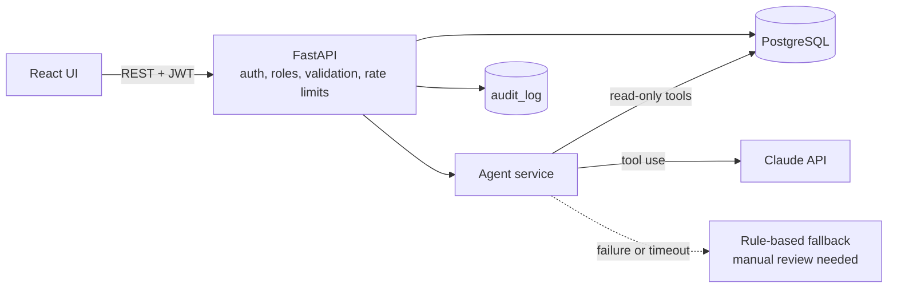

# Infra Change Assistant

An LLM-assisted, human-approved platform for infrastructure change requests.

Engineers submit a change (add a server, open a port, grant access, change a config). An AI agent reviews it against a policy library and past requests, lists risks and proposes a plan. A human approver makes the final call, and every step is written to an append-only audit log.

**AI assists, humans decide.** The agent can only read data and write a proposal. It cannot approve anything, and it cannot change real infrastructure: requests only move through states.

**Stack:** React, FastAPI, PostgreSQL, Claude API, Docker Compose, GitHub Actions

<!-- Add after you take them: -->
<!--    -->

## Why this exists

Infrastructure changes are usually reviewed by hand against many policies. Reviews are slow, reviewers apply rules inconsistently, and there is rarely a clear record of who approved what and why. This project shows a safer pattern: AI does the first pass, a person decides, and everything is traceable.

## Features

- Request submission with type, target, justification and risk level
- AI review: policy search, similar past requests, risk list and a proposed plan
- Approval queue with comments; the requester cannot approve their own request
- Append-only audit log of every submission, review and decision
- Dashboard with counts by status and risk and average time to decision
- Graceful failure: if the LLM is unavailable, a rule-based check runs and the request is flagged "manual review needed"
- Roles: engineer, approver, admin (least privilege)
- Structured JSON logs, `/metrics` and `/health` endpoints
- Accessible React UI (semantic HTML, labelled fields, keyboard navigation)

## Architecture



Flow: UI -> API (auth + validation) -> database -> agent -> LLM + read-only tools -> review stored -> approver decision -> audit log.

## Run it (3 commands)

Requires Docker Desktop.

```bash
cp .env.example .env            # then edit the secrets in .env
docker compose up --build
open http://localhost:3000      # API docs at http://localhost:8000/docs
```

Sign in with `ADMIN_EMAIL` / `ADMIN_PASSWORD` from `.env`, or the demo accounts `engineer@example.com` and `approver@example.com` (password `DEMO_PASSWORD`). Without `ANTHROPIC_API_KEY`, every review uses the rule-based fallback and is flagged "manual review needed". Add a key to enable the AI review.

## Develop without Docker

```bash
# backend (uses SQLite locally)
cd backend && python3 -m venv .venv && source .venv/bin/activate
pip install -r requirements-dev.txt
pytest -q && ruff check .
ADMIN_EMAIL=admin@example.com ADMIN_PASSWORD='a-long-admin-password' \
SEED_DEMO_USERS=true DEMO_PASSWORD='a-long-demo-password' uvicorn app.main:app --reload

# frontend (new terminal)
cd frontend && npm install && npm run dev      # http://localhost:5173
```

## How the agent works

| Piece | Detail |
|---|---|
| Tools | `search_policies(query)`, `find_similar_requests(request_id)`, `propose_plan(...)`. All read-only; `propose_plan` only records a proposal. |
| Output | Validated against a Pydantic schema. Malformed output gets one retry, then the fallback runs. |
| Limits | Wall-clock timeout for the whole review (`LLM_TIMEOUT_SECONDS`), max turns, every tool call and token count logged. |
| Fallback | Any failure (no key, API error, timeout, bad output) runs `app/rules.py` and flags the request `manual_review`. |
| Prompt injection | Request text is wrapped in `<request>` tags and declared untrusted; tools are read-only; the model cannot look up other requests; its approval power is zero. |

## Evaluation

30 labelled sample requests in `backend/eval/samples.json` (10 low/approve, 10 medium/escalate, 7 high/reject, 3 high/escalate).

```bash
cd backend
python -m eval.run_eval --no-llm                       # rule-based baseline
ANTHROPIC_API_KEY=sk-... python -m eval.run_eval       # LLM agent
```

| Metric | Rule-based baseline | LLM agent |
|---|---|---|
| Samples | 30 | 30 |
| Risk-level accuracy | 83.3% | _fill in after running_ |
| Recommendation accuracy | 43.3% | _fill in after running_ |
| High-risk precision | 100% | _fill in after running_ |
| High-risk recall | 90% | _fill in after running_ |
| Fallback rate | 100% (no LLM) | _fill in after running_ |

The baseline's recommendation accuracy is low by design: the fallback always escalates to a human, so it never outputs "reject".

> The expected labels were written by the project author, not an independent reviewer. The evaluation database has no past decided requests, so `find_similar_requests` returns nothing during evaluation.

## API overview

| Endpoint | Who | Purpose |
|---|---|---|
| `POST /auth/login` | anyone (rate limited) | Returns a short-lived JWT |
| `POST /auth/register` | admin | Create a user |
| `GET /auth/me` | any user | Current user |
| `POST /requests` | engineer | Submit a request |
| `GET /requests`, `GET /requests/{id}` | engineer (own), approver, admin (all) | List and view |
| `POST /requests/{id}/review` | engineer (own), approver | Run the AI review (rate limited) |
| `POST /requests/{id}/decision` | approver | Approve or reject with a comment; not on your own request |
| `GET /policies` / `POST`, `PUT /policies/{id}` | any / admin | Policy library |
| `GET /users`, `GET /audit`, `GET /metrics` | admin | Users, audit log, service metrics |
| `GET /dashboard` | approver, admin | Counts by status and risk, average time to decision |
| `GET /health` | anyone | Liveness plus database check |

Request status: `submitted` -> `reviewed` (AI ok) or `manual_review` (fallback) -> `approved` / `rejected`. A decision requires a review first, and a decided request is final.

## Testing and CI

- 27 backend tests (auth, roles, validation, approval flow, agent fallback), plus `ruff` linting
- GitHub Actions runs backend tests and lint, the frontend build, and the Docker build on every push

## Security and limitations

Done:
- bcrypt password hashing; JWT with 30-minute expiry; role read from the database on every request
- Role check on every protected endpoint (least privilege); engineers get a 404, not a 403, for other people's requests
- Strict input validation (types, lengths, allowed values, unknown fields rejected); parameterized queries
- Login and review rate limits; the same login error for unknown email and wrong password
- Secrets only from environment variables; `.env` is git-ignored
- Audit log is append-only at the ORM level

Known limitations:
- The JWT is kept in `sessionStorage`, which an XSS bug could read. A production app would use an httpOnly cookie plus CSRF protection.
- Rate limits and metrics are in process memory, so the backend runs one worker. Use Redis and a metrics system to scale out.
- `create_all` creates the tables. Use Alembic migrations for real deployments.
- The audit log is append-only in application code only; database-level permissions or triggers would make it tamper-resistant.
- Policy search is keyword matching, not embeddings.
- The LLM call runs inside the request. A job queue would be better for slow reviews.
- No password reset, no account lockout, and no HTTPS termination (put it behind a TLS proxy).

## License

MIT (add a `LICENSE` file) or your choice.
